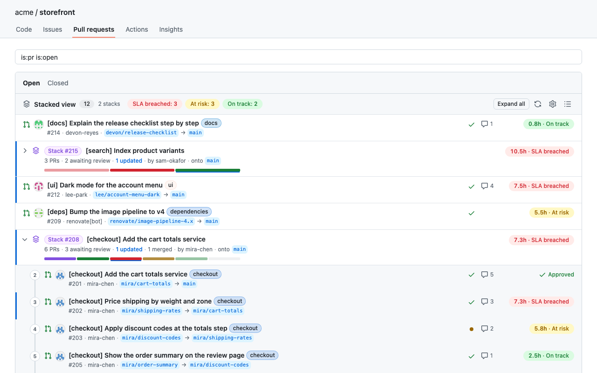

# Stacked PRs for GitHub

A Chrome extension that makes stacked pull requests easy to read on GitHub and GitHub Enterprise Cloud (`*.ghe.com`).

- **Pull request list** (`/<owner>/<repo>/pulls`): replaces GitHub's flat list with a stacked view. Each stack is a
  collapsible row with its members in stack order, a progress bar (one segment per pull request, colored by review
  state, and green once a person or a bot such as CodeRabbit approved it; click a segment to open it) and the longest
  wait in the stack. Every row shows the author's avatar, checks,
  comments and a review SLA pill. As in GitHub's own list, a blue bar marks pull requests updated since you last
  viewed them, and a stack's header says how many of its pull requests were updated, so a collapsed stack shows it too.
  The summary pills (SLA breached, at risk, on track) filter the list. Use the list icon to switch back to GitHub's own
  list.
- **Pull request page**: a floating stack navigator showing the base branch, every pull request in the stack, where you
  are, a blue dot on the ones updated since you last viewed them, and previous/next buttons that keep you on the same
  tab (Files changed stays Files changed).

Stacks come from GitHub's native stacks (`gh stack link`, REST `GET /repos/{owner}/{repo}/stacks`). Pull requests in
no native stack are still grouped when one's base branch is another's head branch ("Stack · from branches").



## Install

> The extension is in review on the Chrome Web Store. Until it is listed, install it from this repository as below.

### 1. Get the code

With git, so you can update later with one command:

```sh
git clone https://github.com/thatprakhar/stacked-prs-for-github.git
```

Or without git: on this repository's page click **Code → Download ZIP** and unzip it. Keep the folder somewhere
permanent; Chrome loads the extension from it every time it starts, so deleting or moving it removes the extension.

### 2. Load it in Chrome

1. Go to `chrome://extensions`.
2. Turn on **Developer mode** (top right).
3. Click **Load unpacked** and choose the folder from step 1 (the one that contains `manifest.json`).
4. Optional: pin it from the puzzle-piece menu in the toolbar. Its icon opens the settings page.

Chrome may show a banner about developer-mode extensions when it starts; that is expected for extensions loaded this way.

### 3. Add a GitHub token

1. Open any repository's **Pull requests** tab on github.com or your company's `*.ghe.com`.
2. The extension shows **Add a token**. Click it: the settings page opens with that host already added.
3. Paste a token and click **Save**. The row should then say *Signed in as* your username.

The quickest way to get a token is the GitHub CLI; the exact command for each host is shown on the settings page:

```sh
gh auth token --hostname github.com            # or your-company.ghe.com
```

Without the CLI, create a [fine-grained token](https://github.com/settings/personal-access-tokens/new) with read access
to **Pull requests** and **Metadata** on the repositories you use. The token stays in your browser and is used only by the
extension's background worker to call the GitHub API of that host; pages never see it.

### Update

```sh
cd stacked-prs-for-github && git pull
```

Then click the reload icon on the extension's card in `chrome://extensions` and refresh GitHub. With the ZIP, download
it again, replace the folder's contents and reload the same way.

### Uninstall

Click **Remove** on the extension's card in `chrome://extensions`. This also deletes the saved tokens and settings.
Once the Chrome Web Store version is available, remove this copy before installing that one, so the two do not run
side by side.

## Review SLA

The clock starts at the latest *ready for review* event, or when the pull request was opened if it was never a draft,
and counts only work hours (default Mon–Fri 9:00–18:00 in the browser's time zone). It stops at the first review by a person,
or when a bot such as CodeRabbit approves. Other bot reviews and the author replying to comments do not count. Defaults:
SLA 6 hours, at risk after 3. All of this is editable in the settings page.

| Pill | Meaning |
|---|---|
| `7.2h · SLA breached` | Waited at least the SLA with no human review |
| `4.1h · At risk` | Waited at least the at-risk threshold |
| `1.0h · On track` | Below the at-risk threshold |
| Approved, Changes requested, Reviewed | A person has reviewed it; the clock has stopped |
| Bot approved | A bot such as CodeRabbit approved it and no person has reviewed it yet; the clock has stopped |
| Draft, Merged, Closed | Not on the clock |

## Publish to the Chrome Web Store

1. Raise `version` in `manifest.json` (every upload needs a higher one), run `npm test`, then `npm run package`.
2. In the [developer dashboard](https://chrome.google.com/webstore/devconsole), upload
   `dist/stacked-prs-for-github-<version>.zip` (a new item the first time, **Package → Upload new package** after).
3. Fill in the listing from [`store/listing.md`](store/listing.md) and submit for review. The privacy policy the
   listing links to is [`store/privacy-policy.md`](store/privacy-policy.md) in this repository.

## Develop

No build step and no dependencies. Node 22 or later.

| Purpose | Command |
|---|---|
| Unit tests (work hours, review state, stack grouping) | `npm test` |
| Live preview of the content scripts without installing | `GITHUB_HOST=<host> node dev/server.js`, then open the printed URL with `?host=<host>&repo=<owner>/<repo>&q=<search>` for the list or `&pr=<number>` for the navigator. The server answers API calls with the GitHub CLI's token. |
| Zip the extension for the Chrome Web Store (`dist/stacked-prs-for-github-<version>.zip`) | `npm run package` |
| Render the store screenshots and promo tile from the fictional data in `dev/demo.js` | `dev/store-assets.sh` |
| Regenerate the icons | `python3 dev/make-icons.py icons` |

| Path | Holds |
|---|---|
| `manifest.json` | Manifest V3: content scripts on `github.com` and `*.ghe.com`, API host permissions |
| `src/background.js` | Holds the token and makes every GitHub API call |
| `src/shared/` | Pure logic shared with the tests: `work-hours.js`, `review-status.js`, `stacks.js` |
| `src/content/` | Page code: API client, rendering, the list view, the PR page navigator, `main.js` (routing and re-mounting on GitHub's client-side navigation) and `styles.css` (Primer CSS variables, so light and dark themes follow GitHub) |
| `options/` | Settings page: tokens per host (only `github.com` is listed until a `*.ghe.com` host is used or added), SLA and work hours |
| `dev/` | Preview server and page, fictional demo data, store asset and icon scripts |
| `store/` | Chrome Web Store listing text, privacy policy, screenshots and promo tile |

The list view finds GitHub's own list by taking the nearest common ancestor of the links to pull requests in the page,
hides it and inserts its own list before it, so it does not depend on GitHub's class names. It shows up to 200 pull
requests matching the search box query (or the `q` URL parameter).

## License

[MIT](LICENSE)
